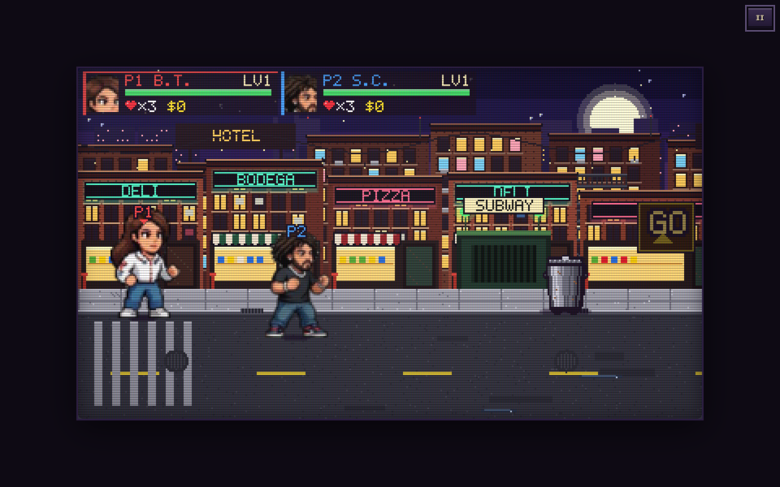
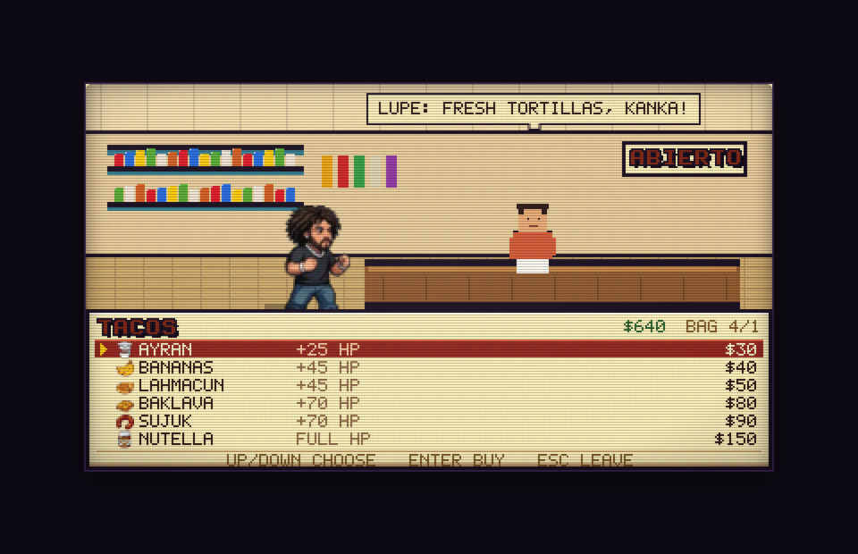

# KANKA KOMBAT: NUTELLA NIGHTS

A 16-bit co-op beat-'em-up in the Streets of Rage / Final Fight school — B.T. and
S.C. chasing the last jar of Nutella through New York, İzmir, İstanbul and Tampa.
Runs in the browser; built with TypeScript, Vite, Canvas 2D and a deterministic
60 Hz simulation shared by solo, host-authoritative relay rooms and the Node server.

**Play now: <https://xiondigital.net/kankakombat/>**





## Play

```bash
npm install
npm run dev          # http://localhost:5173
npm run server       # optional dedicated WebSocket server (PORT=8799)
npm test             # 47 simulation / flow / net tests
npm run test:e2e     # Playwright online acceptance tests
npm run verify:live  # redirect + edge cache + live fighter select on the deployed build
npm run build        # sprites + fonts + typecheck + production bundle
```

Pushing to `main` runs the tests, builds the client and publishes `dist/` to GitHub
Pages (`.github/workflows/pages.yml`), so the live page at xiondigital.net/kankakombat
is always the build from the tip of `main`.

GitHub Pages matches project paths case-sensitively, so the pre-rename
`xiondigital.net/KankaKombat/` address cannot be answered by this repo. It is forwarded
by `KankaKombat/index.html` in the `xiondigital.github.io` repo, which keeps `?room=`
invite codes intact. A real edge `301` and asset caching need the domain proxied through
Cloudflare; the exact records, rule expressions and verification steps are in
[docs/cloudflare.md](docs/cloudflare.md).

## Features

- **Two heroes** — B.T. (speed and combos) and S.C. (power and grapples) — each with
  their own combo chain, heavy, air/run attacks, grab, knees and throws.
- **Four chapters / seventeen sections** — NY night, İzmir sunset, İstanbul morning,
  Tampa afternoon. Each chapter walks street → peaceful plaza → street → boss arena:
  the fighting streets lock the camera for a wave and blink the GO sign, the plaza is
  a quiet town stretch with no waves and no traffic. New York also has a subway
  transport stretch between Flatbush and the plaza: down the stairs, along the
  Broadway–Lafayette platform (no waves, one newsstand), back up the far end.
- **Painted stage strips** — every street is one of the supplied concept scenes,
  imported as a scrolling strip and drawn behind the fighters. Each strip declares the
  shops it already paints (bodega doorway, bazaar stalls, taco truck), and the campaign
  puts its shops on those anchors, so the storefront under the `SHOP` tag is the one you
  enter and no street repeats a frontage. Spots a strip leaves bare get a booth built
  there: a striped market stall for a shop, the vendor's own cart for a vendor.
- **Peaceful areas** — a plaza per chapter with both shop kinds (storefront and street
  vendor booth), food on the ground, and eight townsfolk (Muse, the boombox man, the
  Turkish man and woman, the hijab woman, the Tampa man, the Latina woman and the
  elderly woman) crossing in both directions with their own stride speed. They never
  collide, never fight and are never simulated: pure ambience, like River City Ransom.
- **Four concept bosses** — Dumpster Duke, Bıyıklı Fehmi, the Dondurma Man and the
  Tampa Man — with phases, telegraphs, summons and purses.
- **Bitmap typography** — TITLE and HUD fonts generated from the approved lettering
  sheet, with Ç Ğ İ Ö Ş Ü. No system font is used anywhere in the UI.
- **HUD** — portrait panels (gold P1 / silver P2), health that drains green → yellow
  → red and pulses when critical, boss bar, lives, wallet, bag and stage banners.
- **Destructibles** — bins, crates, boxes, barrels and mailboxes take three hits
  (intact → damaged → smashed), burst into debris and pop stage-flavoured food. Each
  state has its own sprite: the can dented and lidless, the crate cracked, the box
  crushed and taped, the barrel staved, the mailbox tipped, and a wide wreckage pile
  on the third hit.
- **Traffic hazards** — a yellow cab on Bedford Row, a red tram on Galata, a motorbike
  and a food-delivery bicycle on the Turkish streets cross on a telegraph: big enough
  next to a 68 px fighter to read as a vehicle, with a warning, a contact shadow and a
  hit box that matches the art.
- **Shops** — BODEGA, BAKKAL, PAZAR and TACOS interiors with the keeper behind the
  counter, the hero at the counter and a cream bitmap menu (icons, prices, triangular
  cursor, wallet, bag, speech bubble). Street vendors open the same menu. Every shop
  you can walk into is marked from across the street: a bobbing `SHOP` tag carrying the
  city's coin, a chevron pointing at the door and a lit threshold on the pavement,
  brightening as the player walks up.
- **Economy** — Ayran 30, Bananas 40, Lahmacun 50, Baklava 80, Sujuk 90, Nutella 150.
  One wallet all campaign; the symbol changes to ₺ or $ with the city.
- **Bilingual UI** — English / Türkçe switch in the main menu and settings, persisted
  with all player-facing menus, help, shop dialogue, chapter and boss text.
- **Soundtrack** — five supplied themes stream from `public/assets/music/`: the title
  track on every out-of-game screen and one track per city, carried through both
  streets, the shop break and the boss fight, cross-faded and resumed where it left
  off. A missing file falls back to the original chiptune loops.
- **Settings** — music and effects volume, mute, screen shake, touch controls,
  remappable keyboard and gamepad support.
- **Online** — five-character room codes, host-authoritative rooms over a Supabase
  Realtime broadcast relay (no game server needed, so the static Pages build can host
  rooms), or a dedicated Node server; drop-in, reconnect with the same token,
  authoritative purchases. The room creator's tab runs the simulation; guests send input
  and receive interpolated snapshots.

## Controls (default)

The keyboard is laid out like an emulator pad: the two attack buttons sit under the right
hand, everything else is one reach away, and no action lives outside the left block.

| Action | Keyboard | Pad |
|---|---|---|
| Move | Arrows | D-pad / left stick |
| Light / combo — and confirm | Z | X |
| Heavy / throw — and cancel | X | Y |
| Jump | A or Space | A |
| Grab / pick up / enter shop | S | B |
| Dodge roll | D | LB |
| Block (hold) | C | RB |
| Run (hold) | V | RT |
| Eat bag item | Q or E | LT |
| Next bag item | W or F | Back |
| Pause / start / continue | Enter (or Esc in game) | Start |

Menus follow the same two buttons everywhere: **Z / A / Start** confirms and **X / B**
cancels, on the title card, the main menu, fighter select, pause, the lobby and the farewell
screen. The pad moves focus with the d-pad or either stick. All keys are remappable in
**How to Play**; the pad layout is the standard Xbox mapping (A/B/X/Y, bumpers, triggers,
Back, Start) and is fixed, so the same muscle memory works on every controller. Gamepads,
keyboard and touch share one input bitmask.

## Project layout

```
src/shared/data/      fighters, enemies, attacks, stages, items, shops, constants
src/shared/sim/       60 Hz deterministic simulation, combat, AI, items, snapshots
src/shared/net/       protocol, host session, room authority
src/client/           renderer, backgrounds, effects, bitmap font, audio, UI, i18n
src/server/           dedicated WebSocket server
tools/sprites/        pixel-art rig + sheet builder (npm run sprites)
tools/art/            sheet importers, web assets (npm run sheets / props / hazards / npcs)
tools/font/           TTF build from the lettering sheet (npm run fonts)
.github/workflows/    test + build + GitHub Pages deploy
ConceptArt/           approved style bible and reference sheets (read-only)
```

## Art pipeline

Both heroes and all four enemies come from the artists' approved pages.
`tools/art/import_sheets.py` segments each pose as a connected blob, strips the
painted drop shadow and sealed paper gaps, anchors standing poses on the planted foot,
sizes the atlas cell to the widest and tallest pose, and splices the hand-drawn
four-frame walk strips in at the same scale as that page's walk row. Item icons, the
golf cart and the HUD portraits are imported the same way by `tools/art/import_props.py`.

Traffic and townsfolk are imported sheets too. `npm run hazards` cuts the four-frame
taxi / tram / motorbike / delivery-bike strips to their own height next to the fighter,
drops any page colour left inside the art (the white gaps between a bike's tubes and its
rider), and writes `public/assets/props/<kind>.png|json`; `HAZARD_SIZE` in `src/client/render/art.ts`
holds that on-screen box, the simulation's hit width (`hitW` in
`src/shared/data/stages.ts`) is kept equal to it, and `npm test` checks both. `npm run
npcs` scales the eight-character pedestrian page into one 4-column atlas
(`public/assets/sprites/npcs.png|json`); the client flips a row for leftbound traffic
and plays its four frames at that walker's own speed.

Street furniture is still hand-authored pixel maps in `src/client/render/art.ts`:
every destructible carries three maps (`kind`, `kind_dmg`, `kind_broken`: intact,
damaged, smashed) and a wide wreckage pile for the third hit.

Production sheets live in `public/assets/sprites/` with JSON atlases; the review
sheets in `.freebuff/preview/` use the approved light-blue background. The binding
rules are in [ART_STYLE_DIRECTIVE.md](ConceptArt/ART_STYLE_DIRECTIVE.md). All art is
original.

## Music

The soundtrack is one title theme and one theme per city, streamed as MP3 rather than
bundled into the JS. The city theme starts with its chapter and plays through both
streets, any shop stop and the boss arena, so a chapter is paced at roughly the length
of its own track — two bots clear a chapter in 2:20–3:05, checked by the stage-pacing
test in `tests/flow.test.ts`. A solo run is longer and the theme loops once. Boss intros,
the victory sting and every effect are synthesized; game over fades the music out.

| Where | File | Length |
|---|---|---|
| Title screen, menus, fighter select, lobby | `title.mp3` | 2:22 |
| Chapter 1 — New York | `nyc.mp3` | 2:28 |
| Chapter 2 — İzmir | `izmir.mp3` | 2:57 |
| Chapter 3 — İstanbul | `istanbul.mp3` | 2:39 |
| Chapter 4 — Tampa | `tampa.mp3` | 2:18 |

Track ids, files and exact lengths live in `src/shared/data/music.ts`, one entry per
theme; a chapter names its theme with `music` in `src/shared/data/stages.ts`.

## Status

See [PROGRESS.md](PROGRESS.md) for the current IMPLEMENTED / VISUALLY VERIFIED /
STILL PLANNED split.
