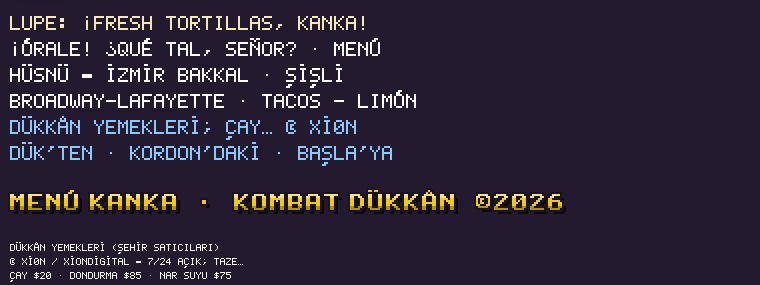
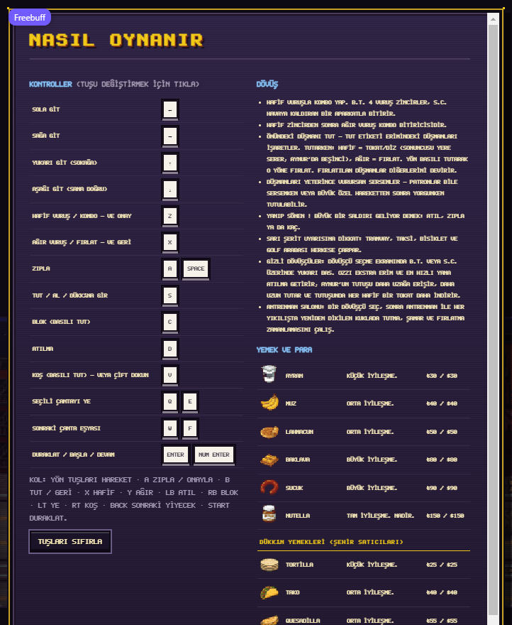

# Fonts

Two bitmap fonts draw every letter in the game: **TITLE** (7×8 chunky arcade caps,
advance 9) and **HUD** (5×7 compact caps, advance 6). They are hand-authored glyph
tables in [src/client/render/font.ts](../src/client/render/font.ts) and rasterised by
the canvas renderer at 1:1. The DOM screens use TTFs generated from the same tables by
[tools/font/build.ts](../tools/font/build.ts) (`npm run fonts` → `public/fonts/`). No
system font is used anywhere in the UI.

## Glyph set

The v1 sheet ([ConceptArt/font_lettering_sheet.png](../ConceptArt/font_lettering_sheet.png))
supplied A–Z, 0–9, punctuation, Turkish Ç Ğ İ Ö Ş Ü and `$`. The extension sheet
([assets/source/font_extension_sheet.png](../assets/source/font_extension_sheet.png))
adds Spanish accents, ñ, inverted marks and the HUD symbols:

| font  | slot | glyphs |
| ----- | ---- | ------ |
| TITLE | 0–25 A–Z, 26–35 0–9, 36–50 symbols, 51–56 Ç Ğ İ Ö Ş Ü, **57–73** | Á É Ó Ú Ñ ¡ ¿ `$` — – ’ · ; … © Ø Â |
| HUD   | 0–25 A–Z, 26–35 0–9, **36–59** | Á É Í Ó Ú Ñ ¡ ¿ Ç Ğ İ Ö Ş Ü `$` `&` — – ’ ; … © Ø Â |

The numbering is a contract, not a redraw order: [tools/font/font_map.json](../tools/font/font_map.json)
is the append-only index, and [tests/font.test.ts](../tests/font.test.ts) fails if a
v1 slot moves or the tables and the map disagree.

Accented letters are **composed**, exactly like the Turkish v1 letters: the v1 base
glyph plus the extension sheet's mark above it (acute for Á É Í Ó Ú, tilde for Ñ). No
base letter was redrawn. One documented approximation: the title cell has no Í of its
own, so title **Í borrows İ's dot** (slot 53); HUD Í is a real acute.

`¡` and `¿` are ordinary glyphs — dot on top, stroke below — stored in the same tables
as `!` and `?`, so they draw from the string, never from a special case.

The dashes and curly quote were a second append (title 65–67, HUD 52–54): the v1 sheet
had no dash at all and only a straight apostrophe. A 5 px cell leaves no room to make an
em dash longer than the full-width v1 hyphen, so the em dash carries two rows of weight
while the en dash keeps the hyphen's single-row measure; the curly quote is the comma
turned up. They are used as authored — chapter-clear banners, `Broadway–Lafayette` and
the Turkish story lines (`Dük’ten`, `Kordon’daki`).

The last copy marks followed (title 68–73, HUD 55–59): the separator dot `·`, semicolon,
ellipsis, `©`, `Ø` and `Â`. `Â` composes like the accents (A plus a circumflex mark);
`©` is a circled C drawn inside the 5×7 cell; `Ø` is the O with a counter-slash. Note
that `&` and `₺` were already in the v1 title table (unindexed), so the title only needed
the separator dot added.

The last one is the cent sign the NYC storefronts advertise (title 74, HUD 60): the v1 `C`
with a stroke down its middle, and in the title the stroke's ends clear the cap so it does
not read as a plain C. `NEON_WORDS` in `backgrounds.ts` is the list those banners pick
from, and the coverage test paints it — which is how `99¢` was caught drawing `?`.

## Case folding

Strings are stored as real Unicode and the text layer folds them. `fold()` in `font.ts`
uses Turkish rules when the UI language is Turkish **or** the string contains a Turkish
letter, and Unicode uppercase otherwise:

| input | UI | output |
| ----- | -- | ------ |
| `istanbul` | tr | `İSTANBUL` |
| `ılık` | tr | `ILIK` |
| `Simit` | en | `SIMIT` (no Turkish letter: English spelling) |
| `Hüsnü — İzmir` | en | `HÜSNÜ — İZMİR` |
| `¡Órale! ¿Qué tal, señor?` | en | `¡ÓRALE! ¿QUÉ TAL, SEÑOR?` |

Never call `toUpperCase()` on a string on its way to `drawText()`: it is wrong for
Turkish (`i` → `I` instead of `İ`) and cannot be undone. Pass the authored string and
let the text layer fold it. The DOM screens use the same uppercase-only webfonts, so
`body { text-transform: uppercase }` does the folding there using the document's
`lang`; dynamic labels also call `fold()`, so the text stored in the DOM is correct
rather than only visually cased. ASCII-folding a diacritic (`MENU` for `MENÚ`) is a bug.

## Unmapped characters

A character with no glyph renders `?` and logs one warning per character naming the
string, e.g. `[font] no hud glyph for "€" (U+20AC) in "A€B"`. Nothing is silently
substituted. At this build every authored string in the game — canvas copy, data tables
and all `en`/`tr` UI strings — has a glyph for every character; `tests/font.test.ts`
fails if one appears that does not.

The HUD font has `·`, `×`, `%`, `♥`, `★`, `₺`, `$` and `&`; prices already use the
currency glyph (`$150` / `₺150`) via `formatMoney`.

## Notes on the drop

- The pre-sliced `glyphs/` PNGs and `font_map.json` were not in the workspace. The map
  was reconstructed to the stated contract, and the sheet's designs were transcribed
  onto the game's own 7×8 / 5×7 grids rather than pasted at the sheet's resolution: the
  sheet is a larger rendition, and re-cutting the whole alphabet would have renumbered
  v1. The TTFs are generated from the transcribed tables, so both paths share one set of
  letterforms.
- The taco room's chalkboard is no longer baked lettering: the room art ships a framed
  blank slate, and the renderer chalks `MENÚ` and the counter's dishes (with their prices,
  right-aligned) on it from the shop's own stock with the HUD glyphs at 1:1
  (`chalkLayout()` in [src/client/render/shops.ts](../src/client/render/shops.ts)). Wall
  text and HUD text are the same font, the same fold, and the same 5×7 grid — the board
  even reads a dish's first word through the same `fold()` the text layer uses to measure it.
- The smooth mixed-case sample supplied for "generic text" is a rendered style
  reference without a font file. Enemy dialogue continues to use the HUD font, which now
  covers the same accents.
